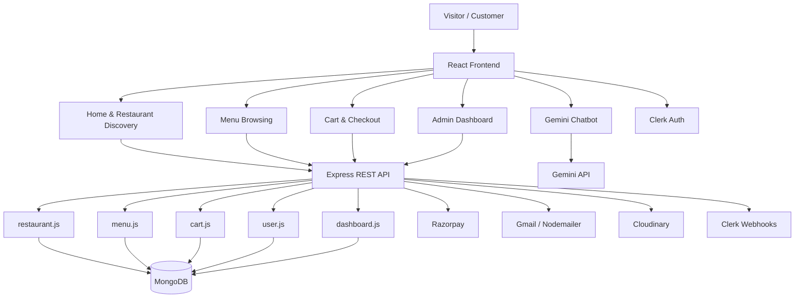

# TasteBudsTreat

Welcome to **TasteBudsTreat**, a full-stack food ordering and restaurant management web application built as a college project using the **MERN** stack. The platform allows users to browse restaurants and dishes, manage a cart, proceed through checkout, and interact with a Gemini-powered AI assistant while leveraging Clerk authentication, Razorpay payments, Cloudinary image uploads, and Gmail-based notifications.

Built by **Arjun Gupta**.

Live application: [https://taste-buds-treat.vercel.app/](https://taste-buds-treat.vercel.app/)

---

## 🥘 Project Overview

**TasteBudsTreat** is designed to simulate a modern food delivery experience where users can:

- browse restaurants and menu items,
- filter by category and food type,
- add items to a cart,
- complete checkout and payment flow,
- view order-related data through the dashboard,
- use AI-assisted customer support and food discovery,
- manage restaurant and menu data from an admin interface.

The application combines a React + Tailwind front end with an Express + MongoDB backend and integrates several third-party services to provide a complete end-to-end experience.

---

## 🚀 Key Features

- **User authentication** via [Clerk](https://clerk.dev/)
- **Restaurant registration and listing**
- **Menu browsing and dish management**
- **Shopping cart with persistent username-based cart tracking**
- **Checkout and Razorpay payment flow**
- **Order history and user spend tracking**
- **Admin dashboard and restaurant/menu forms**
- **Image upload support with Cloudinary**
- **Email communication using Gmail + Nodemailer**
- **Gemini-powered chatbot assistant** for user support and menu recommendations
- **Responsive UI** built with React and Tailwind CSS
- **LocalStorage + Redux synchronization** for cart state
- **Pagination and lazy-loading style UI behavior** across menu and listing sections

> The project is a demo / college project and is not presented as a full production delivery platform. Some flows are front-end simulation logic rather than a complete production-grade commerce backend.

---

## 🧰 Technology Stack

### Frontend

- React.js
- Vite
- Tailwind CSS
- Redux Toolkit
- Axios
- React Router DOM
- MUI / Material Icons
- Framer Motion
- Chart.js + react-chartjs-2

### Backend

- Node.js
- Express.js
- MongoDB with Mongoose
- Multer for uploads
- Cloudinary SDK
- Razorpay SDK
- Nodemailer
- Svix for Clerk webhook verification

### Authentication and Security

- [Clerk](https://clerk.dev/) for authentication and user identity
- Webhook verification for Clerk user creation and deletion events
- Razorpay signature validation during payment verification

### Third-Party Integrations

- Razorpay for payment processing
- Cloudinary for restaurant and dish image uploads
- Gmail via Nodemailer for contact and order emails
- Gemini API for chatbot interactions

---

## 📁 Directory Structure

```plaintext
TasteBudsTreat/
├── Backend/
│   ├── Models/
│   │   ├── Cart.js
│   │   ├── Menu.js
│   │   ├── Restaurant.js
│   │   └── User.js
│   ├── routes/
│   │   ├── cart.js
│   │   ├── dashboard.js
│   │   ├── menu.js
│   │   ├── restaurant.js
│   │   └── user.js
│   ├── .gitignore
│   ├── backend.js
│   ├── package-lock.json
│   ├── package.json
│   └── vercel.json
├── Frontend/
│   ├── public/
│   ├── src/
│   │   ├── Components/
│   │   │   ├── AboutMe/
│   │   │   ├── Admin/
│   │   │   ├── Cart/
│   │   │   ├── ChatBot/
│   │   │   ├── ContactUs/
│   │   │   ├── Footer/
│   │   │   ├── Home/
│   │   │   ├── Main/
│   │   │   ├── Menu/
│   │   │   ├── Navbar/
│   │   │   ├── PaymentSuccess/
│   │   │   └── Redux/
│   │   └── ...
│   ├── .eslintrc.cjs
│   ├── .gitignore
│   ├── components.json
│   ├── index.html
│   ├── package-lock.json
│   ├── package.json
│   ├── postcss.config.js
│   ├── README.md
│   └── tailwind.config.js
├── .gitignore
├── README.md
└── live app: https://taste-buds-treat.vercel.app/
```

---

## 🏗️ High-Level Architecture



### Architectural Summary

The frontend is a Vite-based React application that renders customer and admin screens. The backend exposes REST endpoints for restaurants, menu, carts, user data, and payment flows. MongoDB stores restaurant, menu, cart, and user records, while Cloudinary, Razorpay, Gmail, and Gemini provide supporting services for media, payments, notifications, and AI interactivity.

---

## 🧩 Component Structure

```mermaid
flowchart TD

subgraph group_client["Customer experience"]
  node_app["Route entry<br/>[App.jsx]"]
  node_home["Home discovery<br/>[Home.jsx]"]
  node_menu["Menu browsing<br/>[Menu.jsx]"]
  node_nav["Navigation and sign-in<br/>[Navbar.jsx]"]
  node_cart["Cart and checkout<br/>[Cart.jsx]"]
  node_cartstate["Cart count state<br/>[CartSlice.js]"]
  node_paymentpage["Payment confirmation<br/>[PaymentSuccess.jsx]"]
  node_chatbot["AI chatbot<br/>[Chatbot.jsx]"]
  node_about["About and team<br/>[About.jsx]"]
  node_contact["Contact and FAQ<br/>[ContactUs.jsx]"]
end

subgraph group_management["Restaurant management"]
  node_admin["Admin dashboard<br/>[Admin.jsx]"]
  node_restaurantform["Restaurant registration"]
  node_menumanage["Menu management<br/>[Menu.jsx]"]
end

subgraph group_server["API and persistence"]
  node_api["Express server<br/>[backend.js]"]
  node_restaurantapi["Restaurant API<br/>[restaurant.js]"]
  node_menuapi["Menu API<br/>[menu.js]"]
  node_cartapi["Cart API<br/>[cart.js]"]
  node_userapi["User API<br/>[user.js]"]
  node_dashboardapi["Dashboard API<br/>[dashboard.js]"]
  node_restaurantmodel[("Restaurant records<br/>[Restaurant.js]")]
  node_menumodel[("Menu records<br/>[Menu.js]")]
  node_cartmodel[("Cart records<br/>[Cart.js]")]
  node_usermodel[("User and order history<br/>[User.js]")]
end

subgraph group_integrations["External services"]
  node_clerk["Clerk identity"]
  node_gemini["Gemini API"]
  node_razorpay["Razorpay"]
  node_cloudinary["Cloudinary media"]
  node_gmail["Gmail delivery"]
  node_mongo[("MongoDB")]
end

node_user(("Visitor"))

node_user -->|"opens"| node_app
node_app -->|"routes to"| node_home
node_app -->|"routes to"| node_menu
node_app -->|"routes to"| node_cart
node_app -->|"routes to"| node_admin
node_app -->|"routes to"| node_restaurantform
node_app -->|"routes to"| node_menumanage
node_app -->|"routes to"| node_about
node_app -->|"routes to"| node_contact
node_home -->|"renders"| node_chatbot
node_menu -->|"renders"| node_chatbot
node_menu -->|"fetches restaurants"| node_restaurantapi
node_menu -->|"fetches dishes"| node_menuapi
node_menu -->|"adds items"| node_cartapi
node_menu -->|"updates count"| node_cartstate
node_nav -->|"updates count"| node_cartstate
node_cart -->|"uses state"| node_cartstate
node_cart -->|"renders confirmation"| node_paymentpage
node_cart -.->|"processes checkout"| node_razorpay
node_api -->|"mounts routes"| node_restaurantapi
node_api -->|"mounts routes"| node_menuapi
node_api -->|"mounts routes"| node_cartapi
node_api -->|"mounts routes"| node_userapi
node_api -->|"mounts routes"| node_dashboardapi
node_restaurantapi -->|"reads and writes"| node_restaurantmodel
node_menuapi -->|"reads and writes"| node_menumodel
node_menuapi -->|"updates restaurant"| node_restaurantmodel
node_cartapi -->|"reads and writes"| node_cartmodel
node_userapi -->|"reads and writes"| node_usermodel
node_dashboardapi -->|"reads"| node_usermodel
node_api -->|"creates payment orders"| node_razorpay
node_api -->|"saves order history"| node_usermodel
node_api -->|"reads cart"| node_cartmodel
node_api -->|"sends email"| node_gmail
node_restaurantapi -->|"uploads images"| node_cloudinary
node_menuapi -->|"uploads images"| node_cloudinary
node_api -->|"connects"| node_mongo
node_chatbot -->|"sends prompts"| node_gemini
node_nav -->|"uses sign-in"| node_clerk
node_app -->|"provides identity"| node_clerk

click node_app "https://github.com/arjung352/tastebudstreat/blob/main/Frontend/src/Components/Main/App.jsx"
click node_home "https://github.com/arjung352/tastebudstreat/blob/main/Frontend/src/Components/Home/Home.jsx"
click node_menu "https://github.com/arjung352/tastebudstreat/blob/main/Frontend/src/Components/Menu/Menu.jsx"
click node_nav "https://github.com/arjung352/tastebudstreat/blob/main/Frontend/src/Components/Navbar/Navbar.jsx"
click node_cart "https://github.com/arjung352/tastebudstreat/blob/main/Frontend/src/Components/Cart/Cart.jsx"
click node_cartstate "https://github.com/arjung352/tastebudstreat/blob/main/Frontend/src/Components/Redux/Slice/CartSlice.js"
click node_paymentpage "https://github.com/arjung352/tastebudstreat/blob/main/Frontend/src/Components/PaymentSuccess/PaymentSuccess.jsx"
click node_chatbot "https://github.com/arjung352/tastebudstreat/blob/main/Frontend/src/Components/ChatBot/Chatbot.jsx"
click node_about "https://github.com/arjung352/tastebudstreat/blob/main/Frontend/src/Components/AboutMe/About.jsx"
click node_contact "https://github.com/arjung352/tastebudstreat/blob/main/Frontend/src/Components/ContactUs/ContactUs.jsx"
click node_admin "https://github.com/arjung352/tastebudstreat/blob/main/Frontend/src/Components/Admin/Admin.jsx"
click node_restaurantform "https://github.com/arjung352/tastebudstreat/blob/main/Frontend/src/Components/Admin/Restaurant/Register_Restaurant.jsx"
click node_menumanage "https://github.com/arjung352/tastebudstreat/blob/main/Frontend/src/Components/Admin/Restaurant/Menu.jsx"
click node_api "https://github.com/arjung352/tastebudstreat/blob/main/Backend/backend.js"
click node_restaurantapi "https://github.com/arjung352/tastebudstreat/blob/main/Backend/routes/restaurant.js"
click node_menuapi "https://github.com/arjung352/tastebudstreat/blob/main/Backend/routes/menu.js"
click node_cartapi "https://github.com/arjung352/tastebudstreat/blob/main/Backend/routes/cart.js"
click node_userapi "https://github.com/arjung352/tastebudstreat/blob/main/Backend/routes/user.js"
click node_dashboardapi "https://github.com/arjung352/tastebudstreat/blob/main/Backend/routes/dashboard.js"
click node_restaurantmodel "https://github.com/arjung352/tastebudstreat/blob/main/Backend/Models/Restaurant.js"
click node_menumodel "https://github.com/arjung352/tastebudstreat/blob/main/Backend/Models/Menu.js"
click node_cartmodel "https://github.com/arjung352/tastebudstreat/blob/main/Backend/Models/Cart.js"
click node_usermodel "https://github.com/arjung352/tastebudstreat/blob/main/Backend/Models/User.js"

classDef toneNeutral fill:#f8fafc,stroke:#334155,stroke-width:1.5px,color:#0f172a
classDef toneBlue fill:#dbeafe,stroke:#2563eb,stroke-width:1.5px,color:#172554
classDef toneAmber fill:#fef3c7,stroke:#d97706,stroke-width:1.5px,color:#78350f
classDef toneMint fill:#dcfce7,stroke:#16a34a,stroke-width:1.5px,color:#14532d
classDef toneRose fill:#ffe4e6,stroke:#e11d48,stroke-width:1.5px,color:#881337
classDef toneIndigo fill:#e0e7ff,stroke:#4f46e5,stroke-width:1.5px,color:#312e81
classDef toneTeal fill:#ccfbf1,stroke:#0f766e,stroke-width:1.5px,color:#134e4a
class node_app,node_home,node_menu,node_nav,node_cart,node_cartstate,node_paymentpage,node_chatbot,node_about,node_contact toneBlue
class node_admin,node_restaurantform,node_menumanage toneAmber
class node_api,node_restaurantapi,node_menuapi,node_cartapi,node_userapi,node_dashboardapi,node_restaurantmodel,node_menumodel,node_cartmodel,node_usermodel toneMint
class node_clerk,node_gemini,node_razorpay,node_cloudinary,node_gmail,node_mongo toneRose
class node_user toneIndigo
```



---

## 🔄 Representative Application Flow

1. A user signs in through Clerk.
2. The frontend loads restaurant and menu data via Express endpoints.
3. The backend reads and returns MongoDB records for restaurants and dishes.
4. The user adds a dish to the cart, which is tracked by username and stored in MongoDB.
5. The user proceeds to checkout and creates a Razorpay order.
6. Payment verification validates the signature and records a successful payment.
7. The user record is updated with order history and total spend.
8. Email notifications are sent for contact and order confirmation.
9. The AI chatbot can answer questions using a Gemini endpoint and a predefined menu context.

---

## ⚙️ Prerequisites

Before running the project, ensure you have:

- Node.js v18 or newer
- npm or yarn
- MongoDB instance or MongoDB Atlas connection string
- Clerk account and secret keys
- Razorpay account credentials
- Cloudinary account credentials
- Gmail app password for SMTP
- Gemini-compatible API endpoint or access key if using the frontend API

---

## 🛠️ Setup and Installation

### 1. Clone the repository

```bash
git clone https://github.com/arjung352/tastebudstreat.git
cd tastebudstreat
```

### 2. Install backend dependencies

```bash
cd Backend
npm install
```

### 3. Install frontend dependencies

```bash
cd ../Frontend
npm install
```

### 4. Configure environment variables

Create a `.env` file in the `Backend` directory with the variables listed below.

### 5. Start the backend

```bash
cd Backend
node backend.js
```

For local development, you can also use:

```bash
npx nodemon backend.js
```

### 6. Start the frontend

```bash
cd Frontend
npm run dev
```

### 7. Build the frontend for production

```bash
cd Frontend
npm run build
```

### 8. Preview the production build

```bash
cd Frontend
npm run preview
```

---

## 🔐 Environment Variables

### Backend `.env`

```env
PORT=5000
MONGO_URI=mongodb+srv://<username>:<password>@<cluster>.mongodb.net/tastebudstreat

KEY=your_razorpay_key_id
SECRET=your_razorpay_key_secret

GMAIL_USER=your_email@gmail.com
GMAIL_PASS=your_gmail_app_password

CLOUDINARY_CLOUD_NAME=your_cloud_name
CLOUDINARY_API_KEY=your_cloudinary_api_key
CLOUDINARY_API_SECRET=your_cloudinary_api_secret

CLERK_WEBHOOK_SECRET=your_clerk_webhook_secret
```

### Frontend `.env`

```env
VITE_CLERK_PUBLISHABLE_KEY=your_clerk_publishable_key
VITE_GEMINI_API_URL=https://generativelanguage.googleapis.com/v1beta/models/gemini-2.0-flash:generateContent?key=YOUR_API_KEY
```

> Replace the placeholders with real credentials before running the app. Do not commit real secrets into version control.

---

## 🗃️ Database Schema and Models

The backend uses MongoDB via Mongoose.

### Restaurant Model

File: `Backend/Models/Restaurant.js`

```js
const restaurantSchema = new mongoose.Schema({
  title: { type: String, required: true },
  desc: { type: String, required: true },
  image: { type: String, required: false },
  rating: { type: Number, required: true },
  dish: [{ type: mongoose.Schema.Types.ObjectId, ref: "Menu" }],
});
```

### Menu Model

File: `Backend/Models/Menu.js`

```js
const menuSchema = new mongoose.Schema({
  restaurantId: { type: String, required: true },
  dishName: { type: String, required: true },
  category: { type: String, required: true },
  foodType: { type: String, required: true },
  image: { type: String, required: true },
  price: { type: Number, required: true },
});
```

### Cart Model

File: `Backend/Models/Cart.js`

```js
const cartSchema = new mongoose.Schema({
  productId: { type: String, required: true },
  Username: { type: String, required: true },
  dishName: { type: String, required: true },
  image: { type: String, required: true },
  price: { type: Number, required: true },
  quantity: { type: Number, default: 1 },
});
```

### User Model

File: `Backend/Models/User.js`

```js
const userSchema = new mongoose.Schema(
  {
    clerkUserId: { type: String, required: true, unique: true },
    userName: { type: String, unique: true },
    img: { type: String },
    emailId: { type: String, required: true, unique: true },
    orderHistory: [{ products: [...], totalCost: Number, purchasedAt: Date }],
    totalSpend: { type: Number, default: 0 },
  },
  { timestamps: true }
);
```

This data model stores restaurant metadata, menu items, cart contents, and a user ledger for order history and total spend.

---

## 📚 API Endpoints

### Restaurant routes

| Method | Endpoint                   | Description                                                        |
| ------ | -------------------------- | ------------------------------------------------------------------ |
| POST   | `/api/restaurant/register` | Register a restaurant and optionally upload an image to Cloudinary |
| GET    | `/api/restaurant/get-all`  | Retrieve all restaurants                                           |

### Menu routes

| Method | Endpoint               | Description                                            |
| ------ | ---------------------- | ------------------------------------------------------ |
| POST   | `/api/upload/menu`     | Upload a menu item to Cloudinary and save it as a dish |
| GET    | `/api/upload/all-Dish` | Fetch all menu items                                   |

### Cart routes

| Method | Endpoint              | Description                                           |
| ------ | --------------------- | ----------------------------------------------------- |
| POST   | `/api/cart/AddToCart` | Add an item to the cart                               |
| GET    | `/api/cart/show-cart` | Fetch cart items for a username in the request header |
| DELETE | `/api/cart/delete`    | Remove a cart entry by `_id`                          |
| DELETE | `/api/cart/clear`     | Clear all cart items for a username                   |

### User routes

| Method | Endpoint                  | Description                                                     |
| ------ | ------------------------- | --------------------------------------------------------------- |
| POST   | `/api/user/clerk`         | Clerk webhook endpoint for user.created and user.deleted events |
| GET    | `/api/dashboard/get-user` | Return all user records                                         |

### Payment and email routes

| Method | Endpoint               | Description                                                              |
| ------ | ---------------------- | ------------------------------------------------------------------------ |
| POST   | `/checkout`            | Create a Razorpay order                                                  |
| POST   | `/paymentverification` | Validate Razorpay signature, save payment, and update user order history |
| POST   | `/send`                | Send a contact-form email through Gmail                                  |
| POST   | `/orderConfirm`        | Send order confirmation email                                            |

### Example: Create Razorpay order

```bash
curl -X POST http://localhost:5000/checkout \
  -H "Content-Type: application/json" \
  -d '{"amount": 499}'
```

Example response:

```json
{
  "order": {
    "id": "order_abc123",
    "amount": 49900,
    "currency": "INR",
    "receipt": "order_rcptid_1720000000000"
  }
}
```

### Example: Payment verification flow

The backend verifies the HMAC signature using the Razorpay secret and then stores the payment details and the user order history in the `User` document.

---

## 🔑 Authentication and Authorization

### Identity flow

- The frontend uses Clerk as the primary identity provider.
- User data is synchronized with the backend through the `/api/user/clerk` webhook.
- When a user is created or deleted in Clerk, the backend creates or removes a matching `User` document in MongoDB.

### Admin access

The frontend includes admin navigation and routes like:

- `/Admin`
- `/Register-restaurant`
- `/Register-menu`

In the reviewed source, these routes are exposed in the client UI, but there is no explicit server-side role check in the API layer. The project implements an app-level admin flow rather than a strict authorization policy across all routes.

---

## 🧩 Key Frontend Components

The app uses a component-driven structure under `Frontend/src/Components`:

- `Main/App.jsx` — route configuration and lazy loading
- `Navbar/Navbar.jsx` — navigation, Clerk sign-in/sign-out, and cart badge
- `Home/Home.jsx` — landing page and restaurant discovery
- `Menu/Menu.jsx` — filters and menu browsing
- `Cart/Cart.jsx` — cart view and checkout UI
- `PaymentSuccess/PaymentSuccess.jsx` — payment confirmation screen
- `Admin/Admin.jsx` — admin dashboard
- `Admin/Restaurant/Register_Restaurant.jsx` — add a restaurant
- `Admin/Restaurant/Menu.jsx` — add dishes to a restaurant
- `ChatBot/Chatbot.jsx` — AI chatbot assistant
- `ContactUs/ContactUs.jsx` — contact form and FAQ page

---

## 🚀 Deployment and Production Notes

The project includes Vercel deployment configuration files in the backend and frontend structure, and the production live app is hosted at:

- [https://taste-buds-treat.vercel.app/](https://taste-buds-treat.vercel.app/)


---

## 🧪 Testing and Quality Checks


Available scripts:

```bash
# Frontend
npm run dev
npm run build
npm run lint
npm run preview
```

```bash
# Backend
node backend.js
npx nodemon backend.js
```


---


## 🤝 Contributing

Contributions are welcome for bug fixes, UI enhancements, security improvements, and architecture cleanups.

Suggested workflow:

1. Fork the repository
2. Create a feature branch
3. Implement changes and validate locally
4. Submit a pull request with a clear summary

---
